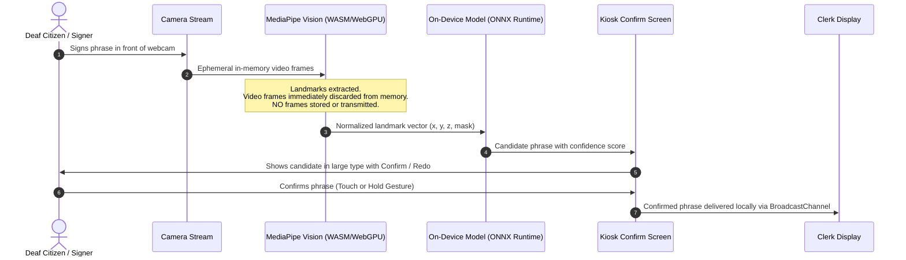

# System Architecture

## 1. High-Level System Flow

```mermaid
flowchart TD
    subgraph Browser ["Client Browser (On-Device, Offline)"]
        Cam[Webcam Video Stream] --> MP[MediaPipe Tasks Vision\nHand & Pose Landmarker]
        MP -->|Landmarks Only\n21 Hand x2 + 33 Pose| Buffer[Frame Rolling Buffer\n& Missingness Masks]
        
        Buffer --> Energy[Motion Energy Segmentation\nStart / Stop Trigger]
        Energy --> Preproc[Normalization & Feature Extraction\n30-Frame Resampling + Velocities]
        
        Preproc --> Worker[Web Worker / ONNX Runtime Web\nBiGRU / Tiny Transformer]
        
        Worker --> Masking[Service Flow Engine\nLogit Masking & Dynamic Thresholding]
        
        Masking --> ConfirmUI[Kiosk Citizen Screen\nLarge Phrase + Confirm / Redo]
        
        ConfirmUI -->|Explicit Citizen Confirm| Comm[Local BroadcastChannel / Firestore]
        Comm --> ClerkUI[Clerk Screen\nTimeline, Gloss, Quick Reply]
        
        ClerkUI -->|Push-to-Talk / Quick Reply| ClerkToCit[Clerk-to-Citizen High Contrast Display]
    end
    
    style Cam fill:#ffebee,stroke:#c62828
    style MP fill:#e8f5e9,stroke:#2e7d32
    style Worker fill:#e1f5fe,stroke:#0277bd
    style ConfirmUI fill:#fff3e0,stroke:#ef6c00
```

---

## 2. Privacy & Data Boundary Guarantee

---

## 3. Subsystem Breakdown

1. **Vision & Landmark Pipeline:**
   - MediaPipe Tasks Vision (`HandLandmarker` and `PoseLandmarker`) runs locally in browser.
   - Extracts coordinates $(x, y, z)$ and visibility presence flags for 33 pose landmarks and $2 \times 21$ hand landmarks.
   - Zero video retention: frames are analyzed frame-by-frame and immediately garbage-collected.

2. **Temporal Segmentation & Preprocessing:**
   - Computes kinetic motion energy from wrist and finger landmark displacements.
   - Motion start/stop boundaries define signing windows, capped between min and max frame bounds.
   - Normalization standardizes scale and position relative to torso/shoulder landmark midpoint.

3. **Inference & Service-State Logit Masking:**
   - Lightweight model (under 2 MB, under 50 ms latency).
   - Dynamic masking layer suppresses classes that are illegal in the current service workflow step, renormalizing probabilities over legitimate choices.

4. **Kiosk Interaction & Clerk Bridge:**
   - Citizen screen enforces accessibility: minimum 32px body text, 64px detection text, high-contrast palette, zero audio dependence.
   - Local IPC via `BroadcastChannel` connects citizen and clerk browser tabs on the same kiosk machine with zero network latency or internet requirement.
